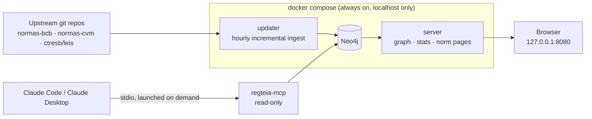

# Regteia

**Brazilian financial regulation as a graph, on your own machine.** Which norm revokes, amends, cites or regulates
which, down to the article, and what was in force on a given date. Explore it in the browser, or ask your local AI
assistant.

> [!WARNING]
> Pre-alpha. The repository is being scaffolded; interfaces below are the target design.

> [!IMPORTANT]
> Automated conversion, for information only. It does **not** replace the Diário Oficial da União or the official
> BCB and CVM portals. Always check the official source linked in every answer before relying on it.

## Why

Anyone working in compliance, legal or product at a Brazilian financial institution, fintech or crypto company
asks the same questions every week:

- Is this resolution still in force? **Which articles** were amended, and by what?
- What does this norm rest on, and what came after it?
- What will be in force on **1 January 2027**, given amendments already published with a future start date?

The texts are already public and converted to Markdown thanks to the
[normas-bcb](https://github.com/BrunooMoniz/normas-bcb) and [normas-cvm](https://github.com/BrunooMoniz/normas-cvm)
projects (63,583 norms, 72,198 norm-to-norm relations). Regteia builds on them and adds what a file-based corpus
can't do well:

| | Upstream corpora | Regteia |
|---|---|---|
| Norm text in Markdown | ✅ | ✅ (ingested) |
| Norm-level relations (revoga, altera, cita…) | ✅ from headers | ✅ |
| **Article-level amendments with effective dates** | text only | ✅ parsed into edges |
| **"In force on date X"** | — | ✅ `vigencia_em` |
| **Multi-hop traversal** (amendments of amendments) | — | ✅ Neo4j |
| Citations found in the body text | — | ✅ deterministic extractor |
| Federal laws as real nodes with text | link only | ✅ via ctresb/leis |
| Interactive graph + live corpus statistics | static images | ✅ local web app |

No LLM runs anywhere in the data pipeline: every edge comes from official headers or rule-based parsing and records
where it came from.

## What runs where

Everything is local. Nothing is hosted, and nothing listens beyond `127.0.0.1`.



- **The Regteia service** (Docker Compose): Neo4j, an `updater` that pulls upstream changes every hour, and a web
  app with the graph visualization and corpus statistics.
- **The MCP server** isn't a service: your AI client starts it as a subprocess when it needs it, over stdio. It has
  no network port and only runs fixed, read-only queries.

| Package | Role |
|---|---|
| `packages/schema` | Pydantic models and IDs: the contract shared by every package |
| `packages/ingest` | Upstream adapters, parsers (articles, amendments, citations), Neo4j loader, migrations. The only writer |
| `packages/query` | All read logic (`buscar`, `norma`, `relacoes`, `vigencia_em`, `panorama`, `estatisticas`) + the `regteia` CLI |
| `packages/mcp` | Local MCP server (stdio) over `query` |
| `packages/server` | FastAPI: JSON API, graph export, serves the web app |
| `apps/web` | Overview graph (cosmos.gl), stats dashboard, per-norm pages (Cytoscape.js) |

## The web app

At `http://127.0.0.1:8080`:

- **Overview:** the whole corpus as a GPU-rendered force graph ([cosmos.gl](https://github.com/cosmosgl/graph)),
  colored by issuing body (CMN, BCB, CVM, federal law), with filters by body, relation and decade.
- **Statistics:** norms per series and per body, in force / amended / revoked, relations by type and origin, norms
  per decade, unresolved references, parse failures, and the last update (upstream commit, time, files changed).
  All computed live from the database.
- **Norm page** (roadmap step 7): text by article, amendment timeline, an "in force on [date]" switch, and the
  norm's neighborhood (what it amends, what amended it, what it rests on) laid out left to right by date. Until then,
  clicking a norm in the overview opens a side panel with its status, official source and direct relations.

Frontend development: `uv run regteia-server` (API on :8080), then `cd apps/web && npm install && npm run dev`
(http://127.0.0.1:5173, proxies `/api`).

The interface is in Portuguese and English (flags in the header). Strings live in `apps/web/src/locales/*.json`;
to add a language, copy `pt-BR.json`, translate the values and register it in `src/i18n.ts`. The build fails if
a locale file is missing a key. Corpus data (titles, ementas, series names, upstream notes) is never translated.

## Quick start

Requirements: Docker, [uv](https://docs.astral.sh/uv/).

```bash
git clone https://github.com/<owner>/regteia && cd regteia
cp .env.example .env                      # set NEO4J_PASSWORD
docker compose up -d                      # Neo4j, updater, web app
docker compose logs -f updater            # first run clones upstream and loads everything (~2 min + download)
```

To force a full reload later: `docker compose exec updater regteia-ingest full`.

Then open `http://127.0.0.1:8080` (the JSON API is documented at `http://127.0.0.1:8080/api/docs`). The Neo4j Browser is at `http://127.0.0.1:7474` if you want to write Cypher,
for example everything that amended Resolução BCB 520:

```cypher
MATCH (n:Norma {id: "bcb:resolucao-bcb:520"})<-[r:ALTERA|REVOGA_PARCIAL]-(m:Norma)
RETURN m.titulo, type(r), r.desde
```

From the terminal:

```bash
uv sync --all-packages
uv run regteia norma "Resolução BCB 520"
uv run regteia relacoes "Resolução BCB 589" --profundidade 2 --tipo altera
uv run regteia buscar "ativos virtuais"
uv run regteia estatisticas
uv run regteia vigencia "bcb:resolucao-bcb:520#art-88" 2027-01-02   # planned (roadmap step 7)
```

Without uv on the host, the same CLI is in the updater container: `docker compose exec updater regteia norma "ICVM 400"`.
Add `--json` before the subcommand for machine-readable output.

## Using it from your AI assistant (local MCP)

The MCP server runs only on your machine, launched by your client over stdio. The Docker stack must be running.

**Claude Code**

```bash
claude mcp add --scope user regteia -- uv run --directory /absolute/path/to/regteia regteia-mcp
```

**Claude Desktop, Cursor and other clients with a config file**

```json
{
  "mcpServers": {
    "regteia": {
      "command": "/absolute/path/to/uv",
      "args": ["run", "--directory", "/absolute/path/to/regteia", "regteia-mcp"]
    }
  }
}
```

Use absolute paths (`which uv`): desktop apps don't inherit your shell's `PATH`. The server reads Neo4j credentials
from the repo's `.env`.

| Tool | What it does |
|---|---|
| `buscar` | Full-text search over articles; returns norm, article, validity status and official source |
| `norma` | One norm: summary, status, what amended or revoked it, what it amends, cites and rests on; or one article's text |
| `relacoes` | Multi-hop traversal from a norm, filtered by relation type and depth |
| `vigencia_em` | Whether a norm or article was in force on a given date, and why |
| `panorama` | The norms in force on a topic |

## Updates

The `updater` container runs an incremental ingest every hour: it reads the upstream git diff since the last loaded
commit and upserts only the norms that changed. If your machine was asleep, the next run catches up. The loaded
commit is recorded in the database, so every answer can be traced to an exact upstream version. GitHub Actions
only runs the tests.

## Known limits

- **Validity over time, not text over time.** We know *whether* an article applied on a date, but we only have its
  *current* wording (plus history since late 2026). Older wordings are not reconstructed.
- Scanned PDFs went through OCR upstream; those norms are flagged (`ocr: true`) and may contain recognition errors.
- 3,509 references could not be resolved upstream; reducing that number is on the roadmap.
- Upstream is maintained by a single person. Ingest validates every record and fails loudly if the format changes.

## Roadmap

- [x] Scaffold: workspace, Docker Compose stack, migrations, CI
- [x] Norm-level graph with hourly incremental ingest
- [x] Query layer, `regteia` CLI, statistics
- [x] Web: statistics dashboard and overview graph
- [ ] Article split + Portuguese full-text search
- [ ] Local MCP server
- [ ] Article-level amendments, `vigencia_em`, norm pages
- [ ] Body-text citations; fewer unresolved references
- [ ] Federal laws from ctresb/leis

## Credits and license

- Norm texts and the base relation graph: [normas-bcb](https://github.com/BrunooMoniz/normas-bcb) and
  [normas-cvm](https://github.com/BrunooMoniz/normas-cvm) by Bruno Moniz. Federal laws:
  [ctresb/leis](https://github.com/ctresb/leis).
- Code: MIT.
- Norm texts are official acts and are not protected by copyright in Brazil (Lei nº 9.610/1998, art. 8º, IV).