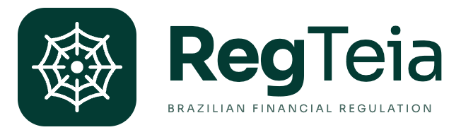
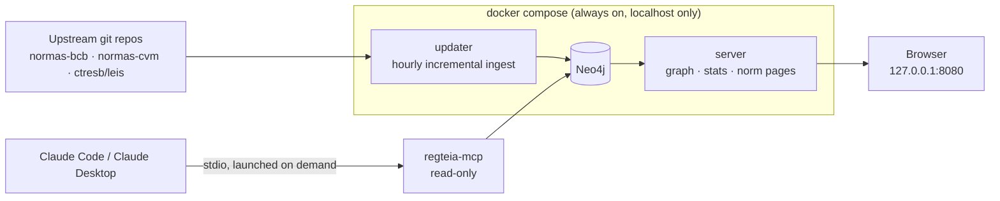
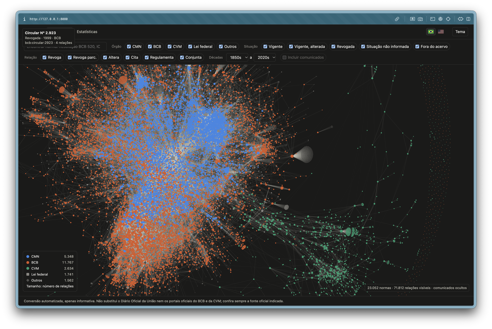
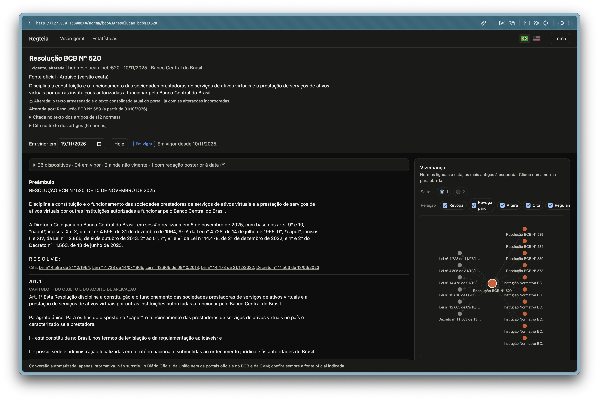
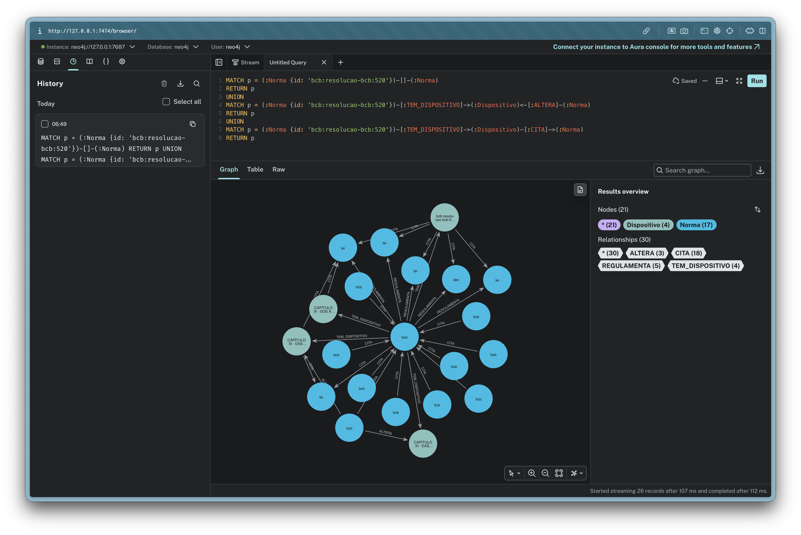

**Brazilian financial regulation as a graph, on your own machine.** Which norm revokes, amends, cites or regulates
which, down to the article, and what was in force on a given date. Explore it in the browser, or ask your local AI
assistant.

> [!WARNING]
> Pre-alpha. The repository is being scaffolded; interfaces below are the target design.

> [!IMPORTANT]
> Automated conversion, for information only. It does **not** replace the Diário Oficial da União or the official
> BCB and CVM portals. Always check the official source linked in every answer before relying on it.

## Why

Anyone working in compliance, legal or product at a Brazilian financial institution, fintech or crypto company
asks the same questions every week:

- Is this resolution still in force? **Which articles** were amended, and by what?
- What does this norm rest on, and what came after it?
- What will be in force on **1 January 2027**, given amendments already published with a future start date?

The texts are already public and converted to Markdown thanks to the
[normas-bcb](https://github.com/BrunooMoniz/normas-bcb) and [normas-cvm](https://github.com/BrunooMoniz/normas-cvm)
projects (63,583 norms, 72,198 norm-to-norm relations). Regteia builds on them and adds what a file-based corpus
can't do well:

| | Upstream corpora | Regteia |
|---|---|---|
| Norm text in Markdown | ✅ | ✅ (ingested) |
| Norm-level relations (revoga, altera, cita…) | ✅ from headers | ✅ |
| **Article-level amendments with effective dates** | text only | ✅ parsed into edges |
| **"In force on date X"** | — | ✅ `vigencia_em` |
| **Multi-hop traversal** (amendments of amendments) | — | ✅ Neo4j |
| Citations found in the body text | — | ✅ deterministic extractor |
| Federal laws as real nodes with text | link only | ✅ via ctresb/leis |
| Interactive graph + live corpus statistics | static images | ✅ local web app |

No LLM runs anywhere in the data pipeline: every edge comes from official headers or rule-based parsing and records
where it came from.

## What runs where

Everything is local. Nothing is hosted, and nothing listens beyond `127.0.0.1`.



- **The Regteia service** (Docker Compose): Neo4j, an `updater` that pulls upstream changes every hour, and a web
  app with the graph visualization and corpus statistics.
- **The MCP server** isn't a service: your AI client starts it as a subprocess when it needs it, over stdio. It has
  no network port and only runs fixed, read-only queries.

| Package | Role |
|---|---|
| `packages/schema` | Pydantic models and IDs: the contract shared by every package |
| `packages/ingest` | Upstream adapters, parsers (articles, amendments, citations), Neo4j loader, migrations. The only writer |
| `packages/query` | All read logic (`buscar`, `norma`, `relacoes`, `vigencia_em`, `panorama`, `estatisticas`) + the `regteia` CLI |
| `packages/mcp` | Local MCP server (stdio) over `query` |
| `packages/server` | FastAPI: JSON API, graph export, serves the web app |
| `apps/web` | Overview graph (cosmos.gl), stats dashboard, per-norm pages (Cytoscape.js) |

### Stack

| Layer | Technology |
|---|---|
| Database | [Neo4j](https://neo4j.com/) 5.26 Community: graph store, Cypher, Portuguese full-text index |
| Backend | Python 3.12, [uv](https://docs.astral.sh/uv/) workspace, Pydantic v2, official `neo4j` driver |
| Ingest | git (blobless, sparse and shallow clones), regex and rule-based parsers, no LLM |
| API | [FastAPI](https://fastapi.tiangolo.com/), graph export as [Apache Arrow](https://arrow.apache.org/) |
| AI access | Official [MCP](https://modelcontextprotocol.io/) Python SDK, stdio transport |
| Frontend | [Vite](https://vite.dev/) + TypeScript, [cosmos.gl](https://github.com/cosmosgl/graph) (GPU force graph), [Cytoscape.js](https://js.cytoscape.org/) + `cytoscape-dagre`, plain SVG charts |
| Runtime | Docker Compose: `neo4j`, `updater`, `server`, all bound to `127.0.0.1` |
| Quality | pytest + [testcontainers](https://testcontainers.com/) (a real Neo4j, no mocks), ruff, GitHub Actions CI |

## The web app

At `http://127.0.0.1:8080`:

- **Overview:** the whole corpus as a GPU-rendered force graph ([cosmos.gl](https://github.com/cosmosgl/graph)),
  colored by issuing body (CMN, BCB, CVM, federal law), with filters by body, status, relation and decade.
- **Statistics:** norms per series and per body, in force / amended / revoked, relations by type and origin, norms
  per decade, unresolved references, parse failures, and the last update (upstream commit, time, files changed).
  All computed live from the database.
- **Norm page:** text by article with the norms each article cites, what amended or revoked it, an "in force on
  [date]" switch, and the norm's neighborhood (what it amends, what amended it, what it rests on) laid out left to
  right by date.

The overview: about 23,000 norms and 72,000 relations (comunicados hidden), sized by number of relations.



The norm page for Resolução BCB 520: status, who amended it and from when, the articles' text with the norms they
cite, and its neighborhood graph (the federal laws it rests on to the left, later norms to the right).



Frontend development: `uv run regteia-server` (API on :8080), then `cd apps/web && npm install && npm run dev`
(http://127.0.0.1:5173, proxies `/api`).

The interface is in Portuguese and English (flags in the header). Strings live in `apps/web/src/locales/*.json`;
to add a language, copy `pt-BR.json`, translate the values and register it in `src/i18n.ts`. The build fails if
a locale file is missing a key. Corpus data (titles, ementas, series names, upstream notes) is never translated.

## Quick start

Requirements: Docker, [uv](https://docs.astral.sh/uv/).

```bash
git clone https://github.com/<owner>/regteia && cd regteia
cp .env.example .env                      # set NEO4J_PASSWORD
docker compose up -d                      # Neo4j, updater, web app
docker compose logs -f updater            # first run clones upstream and loads everything (~2 min + download)
```

The first run clones normas-bcb, normas-cvm and the cited part of ctresb/leis, then keeps them current every hour.
See [Where the data comes from](#where-the-data-comes-from-and-how-it-stays-current). To force a full reload later:
`docker compose exec updater regteia-ingest full`.

Then open the web app. Everything answers only on your machine (`127.0.0.1`), while the stack is running:

| What | Address |
|---|---|
| Web app (overview graph, statistics) | http://127.0.0.1:8080 |
| JSON API docs | http://127.0.0.1:8080/api/docs |
| Neo4j Browser | http://127.0.0.1:7474 |
| Neo4j connection (Browser, drivers) | `bolt://127.0.0.1:7687`, user `neo4j`, password `NEO4J_PASSWORD` from `.env` |

In the Neo4j Browser you can write Cypher, for example everything that amended Resolução BCB 520:

```cypher
MATCH (n:Norma {id: "bcb:resolucao-bcb:520"})<-[r:ALTERA|REVOGA_PARCIAL]-(m:Norma)
RETURN m.titulo, type(r), r.desde
```

Or draw a norm's neighborhood. Resolução BCB 520 with:
- the norms that cite, regulate or amend it;
- its articles amended by Resolução BCB 589;
- the federal laws its articles cite.

```cypher
MATCH p = (:Norma {id: 'bcb:resolucao-bcb:520'})-[]-(:Norma)
RETURN p
UNION
MATCH p = (:Norma {id: 'bcb:resolucao-bcb:520'})-[:TEM_DISPOSITIVO]->(:Dispositivo)<-[:ALTERA]-(:Norma)
RETURN p
UNION
MATCH p = (:Norma {id: 'bcb:resolucao-bcb:520'})-[:TEM_DISPOSITIVO]->(:Dispositivo)-[:CITA]->(:Norma)
RETURN p
```



From the terminal:

```bash
uv sync --all-packages
uv run regteia norma "Resolução BCB 520"
uv run regteia relacoes "Resolução BCB 589" --profundidade 2 --tipo altera
uv run regteia buscar "custódia de ativos virtuais segregação"   # matches article text, shows excerpts
uv run regteia dispositivo "Resolução BCB 520, art. 91"            # one article: text, earlier wording, notes
uv run regteia estatisticas
uv run regteia vigencia "bcb:resolucao-bcb:520#art-88" 2027-01-02   # planned (roadmap step 7)
```

Without uv on the host, the same CLI is in the updater container: `docker compose exec updater regteia norma "ICVM 400"`.
Add `--json` before the subcommand for machine-readable output.

## Using it from your AI assistant (local MCP)

The MCP server runs only on your machine, launched by your client over stdio (no port, no network listener). It is
read-only: five fixed tools over the query layer, no "run Cypher" tool. The Docker stack must be running.

**Claude Code**, no uv needed (runs the server inside the `server` container, still over stdio):

```bash
claude mcp add --scope user regteia -- docker compose -f /absolute/path/to/regteia/docker-compose.yml exec -T server regteia-mcp
```

With uv on the host, instead: `claude mcp add --scope user regteia -- uv run --directory /absolute/path/to/regteia regteia-mcp`
(reads Neo4j credentials from the repo's `.env`).

**Claude Desktop, Cursor and other clients with a config file**

```json
{
  "mcpServers": {
    "regteia": {
      "command": "/usr/local/bin/docker",
      "args": ["compose", "-f", "/absolute/path/to/regteia/docker-compose.yml", "exec", "-T", "server", "regteia-mcp"]
    }
  }
}
```

Use absolute paths (`which docker`): desktop apps don't inherit your shell's `PATH`.

| Tool | What it does |
|---|---|
| `buscar` | Search over article text, titles and summaries; per norm: status (and who revoked or amended it), official source, and the matching articles' text. Common terms ("exchange", "cripto", "PLD", "open finance") are mapped to the regulation's wording |
| `norma` | One norm: summary, status, what amended or revoked it, what it amends, cites and rests on, and its list of articles |
| `dispositivo` | One article (or annex, item): latest wording, chapter and section, revoked or not, struck-through earlier wording, future-date warnings |
| `relacoes` | Multi-hop traversal from a norm, filtered by relation type and depth |
| `panorama` | The norms in force on a topic (no revoked norms, no comunicados) |

`vigencia_em` ("was this article in force on date X?") comes with roadmap step 7.

Try: "Quais são as modalidades de prestadora de serviços de ativos virtuais?", "O que mudou no art. 91 da
Resolução BCB 520?", "Quais normas alteraram a Resolução CMN 4.966 e o que elas mudaram?".

## Where the data comes from, and how it stays current

Regteia doesn't crawl the official portals. It reads public git repositories, listed in `upstreams.toml`, and never
writes to them:

| Repository | What it gives | How it is cloned |
|---|---|---|
| [BrunooMoniz/normas-bcb](https://github.com/BrunooMoniz/normas-bcb) | BCB and CMN norms | full history, no file contents until needed |
| [BrunooMoniz/normas-cvm](https://github.com/BrunooMoniz/normas-cvm) | CVM norms | same |
| [ctresb/leis](https://github.com/ctresb/leis) | federal laws, decrees and MPs | shallow, and only the files BCB/CVM norms cite |

**First run.** The `updater` clones the repositories into the `upstream` Docker volume and loads everything:

- **From normas-bcb and normas-cvm** it takes:
  - each norm's text and header (title, body, date, summary, official link);
  - its status (`grafo/estado.jsonl`);
  - the norm-to-norm relations (`grafo/arestas.jsonl`);
  - the references to other repositories (`grafo/externos.jsonl`);
  - the references upstream couldn't resolve (`grafo/nao_resolvidos.jsonl`).
- **From that same data, Regteia builds** the layers upstream doesn't have:
  - the split into articles;
  - article-level amendments with start dates, parsed from the `atualizacoes` header;
  - "in force on date X";
  - the citations found in article text.
- **ctresb/leis is read last:** the graph decides which federal acts are needed, and only those files are fetched.

**Updates, every hour.**
- The normas repositories are refreshed hourly by their maintainer's crawler, which commits each new or changed norm.
- The `updater` container runs `regteia-ingest incremental` once an hour. For each repository it:
  1. runs `git fetch`;
  2. compares the new commit with the last one loaded (stored in Neo4j as `(:Ingestao {fonte, sha})`);
  3. reads only the files in `git diff last..new`: changed norms are re-parsed, and deleted ones are removed;
  4. records the new commit only after a successful load. A failed run changes nothing and is retried the next
     hour.
- A change on the BCB or CVM portal reaches your graph in about 1–2 hours.
- If your machine was asleep, the next run catches up on every commit it missed. If upstream rewrote its history,
  it reloads everything.
- Every norm keeps the commit and file it came from, so any answer can be traced to an exact upstream version.

Watch it with `docker compose logs -f updater`. Neo4j is never the source of truth:
`docker compose exec updater regteia-ingest full` rebuilds the whole graph from the repositories. GitHub Actions
only runs the tests.

## Known limits

- **Validity over time, not text over time.** We know *whether* an article applied on a date, but we only have its
  *current* wording (plus history since late 2026). Older wordings are not reconstructed.
- Scanned PDFs went through OCR upstream; those norms are flagged (`ocr: true`) and may contain recognition errors.
- 3,509 references could not be resolved upstream; reducing that number is on the roadmap.
- Upstream is maintained by a single person. Ingest validates every record and fails loudly if the format changes.

## Roadmap

- [x] Scaffold: workspace, Docker Compose stack, migrations, CI
- [x] Norm-level graph with hourly incremental ingest
- [x] Query layer, `regteia` CLI, statistics
- [x] Web: statistics dashboard and overview graph
- [x] Article split + Portuguese full-text search
- [x] Local MCP server
- [ ] Article-level amendments, `vigencia_em`, norm pages
- [ ] Body-text citations; fewer unresolved references
- [ ] Federal laws from ctresb/leis

## Credits and license

- Norm texts and the base relation graph: [normas-bcb](https://github.com/BrunooMoniz/normas-bcb) and
  [normas-cvm](https://github.com/BrunooMoniz/normas-cvm). Federal laws:
  [ctresb/leis](https://github.com/ctresb/leis).
- Code: MIT.
- Norm texts are official acts and are not protected by copyright in Brazil (Lei nº 9.610/1998, art. 8º, IV).